# Enterprise Knowledge Assistant (EKA)

| Project detail | Description |
|---|---|
| Program | M.Tech AI-ML |
| Project focus | API-Driven Cloud-Native Solutions |

## Project Objective

Develop an API-driven enterprise knowledge assistant using NLP, model fine-tuning, and Retrieval-Augmented Generation (RAG).

## Technology Stack

- Python
- FastAPI
- Streamlit
- Hugging Face Transformers
- ChromaDB
- LLM API

## Project Status

## Step 1 — Environment Setup

```bash
python --version
python -m venv .venv
```

Activate the virtual environment:

```powershell
# Windows PowerShell
.\.venv\Scripts\Activate.ps1
```

```bash
# macOS/Linux
source .venv/bin/activate
```

Install the project dependencies:

```bash
python -m pip install --upgrade pip
python -m pip install -r requirements.txt
```

## Step 2 — Build a REST API Using FastAPI

Check the API dependencies and create the application files:

```bash
python -m pip show fastapi uvicorn
mkdir -p app/backend
touch app/__init__.py
touch app/backend/__init__.py
touch app/backend/main.py
```

The `__init__.py` files mark the directories as Python packages.

### FastAPI Concepts

1. `FastAPI()` creates the backend application.
2. `@app.get("/")` defines a REST API endpoint that responds to an HTTP GET request at `/`.
3. `@app.get("/api/health")` defines a second endpoint for checking whether the application is running.
4. Returning a Python dictionary: FastAPI automatically serializes the dictionary into a JSON response.

Run the API and test its endpoints:

```bash
python -m uvicorn app.backend.main:app --host 0.0.0.0 --port 8000 --reload
curl http://127.0.0.1:8000/
curl http://127.0.0.1:8000/api/health
```

Interactive API documentation is available at <http://localhost:8000/docs>.

| Argument | Meaning |
|---|---|
| `app.backend.main` | Python module containing the application |
| `:app` | FastAPI application object |
| `--host 0.0.0.0` | Listen on all network interfaces |
| `--port 8000` | Run on port 8000 |
| `--reload` | Restart automatically when code changes |

## Step 3 — Build the Streamlit Frontend and Connect It to FastAPI


The request flow is:

1. The user opens the Streamlit application.
2. Streamlit sends an HTTP GET request to FastAPI.
3. FastAPI processes the request.
4. FastAPI returns a JSON response.
5. Streamlit displays the response.

Create the frontend files:

```bash
mkdir -p app/frontend
touch app/frontend/__init__.py
touch app/frontend/streamlit_app.py
```

## Step 4 — Prepare the Enterprise Knowledge Base

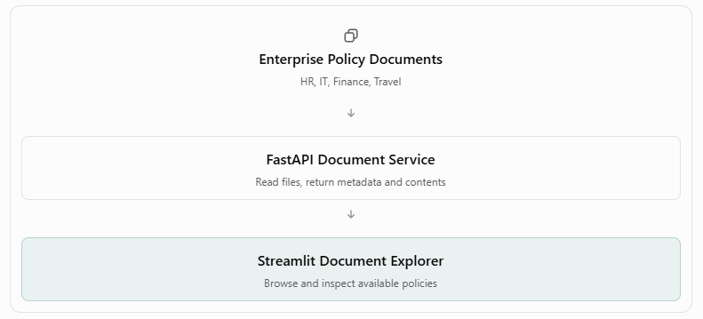

Create the document directory:

```bash
mkdir -p data/documents
```

Create these documents:

1. **Employee Leave Policy:** `data/documents/leave_policy.txt`
2. **IT Support Policy:** `data/documents/it_support_policy.txt`
3. **Expense Reimbursement Policy:** `data/documents/expense_policy.txt`
4. **Business Travel Policy:** `data/documents/travel_policy.txt`

### Create the Document Service

```bash
mkdir -p app/backend/services
touch app/backend/services/__init__.py
touch app/backend/services/document_service.py
```

- `Path(__file__).resolve().parents[3]` identifies the project root based on the service file's location.
- `glob("*.txt")` finds text documents in the directory.
- `file_path.stem` extracts the filename without its extension.

### Create and Test the Document API Endpoints

```bash
curl http://127.0.0.1:8000/api/documents
curl http://127.0.0.1:8000/api/documents/leave_policy
curl -i http://127.0.0.1:8000/api/documents/unknown_policy
```

### Integrate the Document Explorer into Streamlit

## Step 5 — Prepare the Dataset for DistilBERT Fine-Tuning


We selected DistilBERT, a compact transformer-based language model, for classifying employee queries.

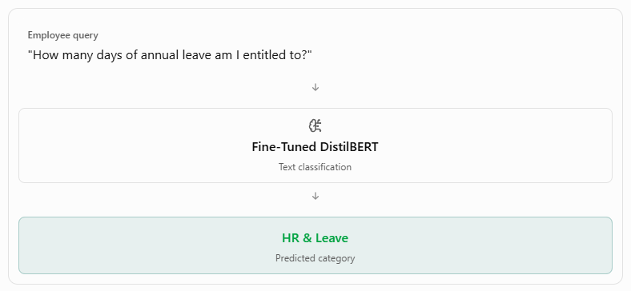

The classifier will help identify the domain of an employee's query, which can later guide RAG document retrieval.

This is a **multi-class, single-label classification problem**: each query receives exactly one category.

| Label ID | Category | Example |
|---:|---|---|
| 0 | HR & Leave | "How do I apply for sick leave?" |
| 1 | IT Support | "My VPN connection is failing." |
| 2 | Finance & Expenses | "When will my claim be reimbursed?" |
| 3 | Travel & Operations | "How do I book a business flight?" |

The dataset is a CSV file with two columns:

- `text`: Employee's query.
- `label`: Numerical category identifier.

Create the dataset and preparation script:

```bash
mkdir -p data/training
touch data/training/employee_queries.csv
python -m pip show pandas scikit-learn
mkdir -p training
touch training/prepare_dataset.py
python training/prepare_dataset.py
```

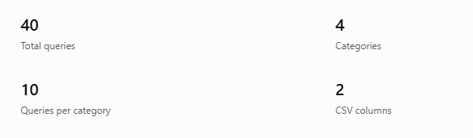

## Step 6 — Fine-Tune DistilBERT for Enterprise Query Classification

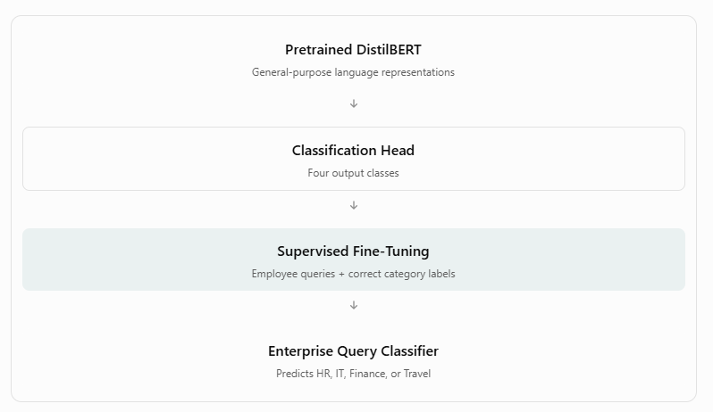

### Step 6A.1 — Build the Curated Intent Catalog

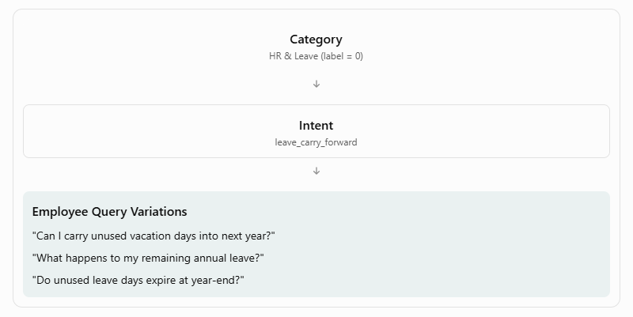

Each query will contain:

| Field | Purpose |
|---|---|
| `text` | Employee's question |
| `label` | Classification target: 0, 1, 2, or 3 |
| `intent_group` | Groups queries that express the same underlying intent |

**Important distinction:** The model will predict `label`, not `intent_group`. The intent group is used for dataset organization and leakage-aware evaluation.

Create the intent catalog and dataset generation script:

```bash
mkdir -p data/training training
touch data/training/intent_catalog.json
touch training/generate_dataset.py
```

The generator performs five operations:

1. Reads the intent catalog from JSON.
2. Iterates through categories, intents, and questions.
3. Checks for empty queries and exact duplicates (ignoring case and repeated whitespace).
4. Creates a structured dataset.
5. Exports the dataset to CSV.

Execute the generator and verify the resulting CSV:

```bash
python training/generate_dataset.py
head -n 6 data/training/employee_queries.csv
```


### Step 6A.2 — Expand the Dataset to 400 Queries

Update the JSON with new intents in each category, then run the generator again:

```bash
python training/generate_dataset.py
```

### Step 6A.3 — Complete the Intent Catalog

Create and run a script to expand the catalog, then regenerate the dataset:

```bash
touch training/expand_intents.py
python training/expand_intents.py
python training/generate_dataset.py
```

### Step 6A.4 — Expand to 400 Queries

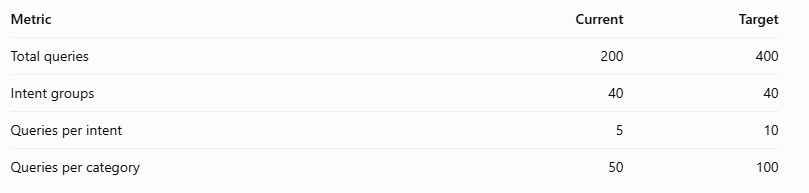

Use a variety of query styles:

- Direct question
- Conversational request
- Scenario-based question
- Procedural question
- Indirect question

Create the expansion worksheet and populate it with diverse queries:

```bash
touch training/create_expansion_template.py
python training/create_expansion_template.py
```

### Step 6B — Validate the Dataset and Create Group-Aware Splits

Now that we have prepared our 400-query dataset, we'll create training, validation, and test datasets for:

1. TF-IDF + Logistic Regression (baseline model)
2. Fine-tuned DistilBERT (transformer model)

#### Why Group-Aware Splitting Matters

Suppose our dataset contains:

| Query | Intent group |
|---|---|
| How can I reset my company password? | `password_reset` |
| I forgot my work login credentials. | `password_reset` |
| Where can I reset my account password? | `password_reset` |

If we randomly split individual rows, similar questions could appear in both training and testing. This creates a risk of data leakage, resulting in overly optimistic evaluation metrics.

Instead, we'll keep all questions belonging to an intent group in the same split.


Create and run the dataset validation and splitting script:

```bash
touch training/prepare_dataset.py
python training/prepare_dataset.py
```

The enterprise query dataset was divided into training, validation, and test subsets using an intent-group-aware strategy. All queries belonging to the same intent were assigned to the same subset, reducing paraphrase leakage between training and evaluation. Category balance was maintained across the three subsets. A fixed random seed was used to support reproducibility.

### Step 6C — Train the TF-IDF Baseline

#### Why Do We Need a Baseline?

Suppose we fine-tune DistilBERT and achieve 85% accuracy. We cannot determine whether that is good without comparison. If a simpler Logistic Regression model achieves 90%, the additional computational cost of DistilBERT might not be justified for this particular dataset.

Create the baseline training script:

```bash
touch training/train_baseline.py
```

#### Why Use a Pipeline?

A scikit-learn `Pipeline` ensures that the TF-IDF vectorizer and Logistic Regression classifier operate together. It also prevents the vectorizer from learning vocabulary and IDF statistics from the validation or test datasets.

#### Why Test Different C Values?

The `C` parameter controls regularization strength. Smaller values mean stronger regularization, while larger values allow the classifier to fit the training data more closely. We'll select the value that produces the best validation macro F1-score.

#### Why Evaluate the Test Set Only After Model Selection?

The test set should remain independent of hyperparameter selection. We use validation performance to choose the model and test performance to estimate generalization.

Train and test the saved model:

```bash
python training/train_baseline.py
touch training/test_baseline.py
python training/test_baseline.py
```

Save evidence of the results.

### Step 6D — Fine-Tune DistilBERT Using the Final Dataset

Create the notebook `notebook/EKA_DistilBERT_FineTuning.ipynb`.

### Step 6E — Integrate the Fine-Tuned Model into FastAPI

Download and extract the model from `/content/eka-distilbert-model.zip`:

```bash
mkdir -p models/distilbert
unzip -o eka-distilbert-model.zip -d models/
```

Install the inference dependencies.


Create the classifier service:

```bash
touch app/backend/services/classifier_service.py
```

The service:

- Loads your locally saved fine-tuned model.
- Tokenizes the employee query.
- Runs inference without updating model parameters.
- Converts logits into softmax scores.
- Returns the predicted category and confidence.

Add the classification API endpoint and test it:

```bash
curl -X POST \
  http://127.0.0.1:8000/api/classify \
  -H "Content-Type: application/json" \
  -d '{"query":"How do I apply for annual leave?"}'
```

### Commit the Fine-Tuned Model to Git LFS

```bash
git lfs install
git lfs track "models/eka-distilbert-model/model.safetensors"
```

The second command creates or updates `.gitattributes`, telling Git to store that weights file with LFS.

Stage the LFS rules and the four files the app needs:

```bash
git add .gitattributes .gitignore \
  models/eka-distilbert-model/config.json \
  models/eka-distilbert-model/model.safetensors \
  models/eka-distilbert-model/tokenizer.json \
  models/eka-distilbert-model/tokenizer_config.json
```

Verify the files tracked by LFS and the repository status:

```bash
git lfs ls-files
git status -sb
```

## Step 7 — Build the RAG Pipeline

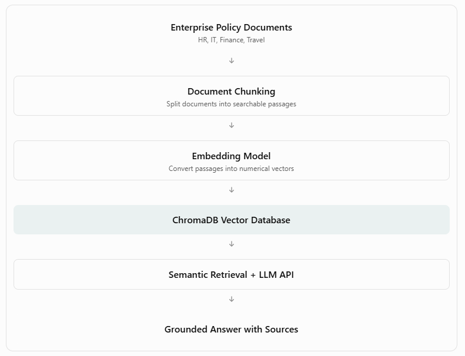

### Step 7A — Implement Document Chunking

Before creating embeddings, we need to divide our enterprise documents into smaller passages called chunks.

#### Why Is Chunking Necessary?

LLMs and embedding models work better when relevant information is organized into manageable passages. For example, an employee asking about leave approval does not necessarily need the entire HR policy. The retrieval system should identify the specific section describing approval.

We'll initially use a simple section-aware chunking approach because our four fictional policy documents already have numbered sections.

Create the chunking service:

```bash
touch app/backend/services/chunking_service.py
```

The pattern `r"(?m)^(?=\d+\.\s+[A-Z])"` identifies the beginning of numbered sections, such as `1. APPROVAL`.

Our implementation preserves the section heading inside each chunk. The first chunk may contain the document title and metadata. We'll keep it for now, although we may exclude metadata-only chunks from semantic retrieval later.

Create and run a test script:

```bash
touch training/test_chunking.py
python -m training.test_chunking
```

### Step 7B — Generate Embeddings and Build the ChromaDB Vector Database

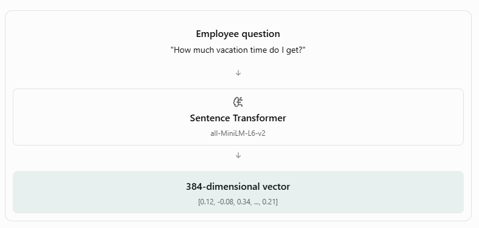

Our selected embedding model, `sentence-transformers/all-MiniLM-L6-v2`, produces 384-dimensional embeddings. The same model will encode both policy passages and employee questions. ChromaDB will compare these vectors to find semantically similar passages.

ChromaDB stores the passage embeddings and their metadata, allowing us to search them efficiently.

Check the required libraries and create the vector database service:

```bash
python -m pip show chromadb sentence-transformers
touch app/backend/services/vector_service.py
```

The vector service uses:

- `SentenceTransformer` to load the embedding model. The first execution may download model files from Hugging Face.
- `PersistentClient` to create a vector database on disk. Unlike an in-memory database, the stored embeddings remain available after the application restarts.
- Upsert operations to add or update records with the supplied IDs.
- Cosine distance to compare vectors. For normalized embeddings, smaller distances generally indicate greater semantic similarity. The distance is not a calibrated probability that the retrieved passage is correct.

One limitation: upsert does not automatically remove chunks that were deleted from the source documents. For our initial static knowledge base this is acceptable, but we'll improve index synchronization when adding document-upload functionality.

Create and run a vector indexing script:

```bash
touch training/build_vector_db.py
python -m training.build_vector_db
```

#### Test Semantic Retrieval

Create and run a retrieval test:

```bash
touch training/test_retrieval.py
python -m training.test_retrieval
```

The correct passage should ideally appear among the top three retrieved results. However, semantic search is probabilistic, so we'll verify the actual ranking rather than assuming that every query will retrieve the correct passage.

#### Expose Semantic Search Through FastAPI

Update `app/backend/main.py` to add `POST /api/search`.

### Step 7C — Build the RAG Chatbot Using the Google Gemini API


#### Step 7C.1 — Create Gemini Credentials Securely

Create `.env` in the project root and check the dependencies:

```bash
touch .env
chmod 600 .env
python -m pip show google-genai python-dotenv
```

#### Step 7C.2 — Implement the LLM Service

Create `app/backend/services/llm_service.py`.

Understanding the implementation:

- `load_dotenv()` loads the secret from the local environment file.
- `get_gemini_client()` creates the authenticated API client and caches it for reuse.
- `client.models.generate_content()` sends our request to Gemini and returns generated content. This method is supported by the official Google Gen AI SDK.
- `temperature=0.1` favors relatively consistent responses, which is useful for policy question answering. It does not guarantee factual accuracy.

#### Step 7C.3 — Test Gemini Independently

```bash
touch training/test_gemini.py
python -m training.test_gemini
```

#### Step 7C.4 — Implement the RAG Service

Create `app/backend/services/rag_service.py`.

The service:

1. Retrieves the top four semantically relevant passages.
2. Combines the passages into a context block.
3. Sends the context and employee question to Gemini.
4. Returns the generated answer and the retrieved source metadata.

**Important:** The `sources` array contains retrieved passages, not independently verified citations. The LLM is instructed to cite those passages, but we'll still need to evaluate whether each answer is genuinely supported.

#### Step 7C.5 — Create the FastAPI Chat Endpoint

Update `app/backend/main.py`.

#### Step 7C.6 — Test the Complete RAG Pipeline

Run the API:

```bash
python -m uvicorn app.backend.main:app \
  --host 0.0.0.0 \
  --port 8000 \
  --reload
```

### Step 7D — Integrate the RAG Chatbot into Streamlit

Our objective is to create a chat interface where employees can:

1. Enter questions in natural language.
2. View AI-generated answers.
3. See supporting document references.
4. Continue a conversation within the interface.
5. Receive meaningful error messages if the backend is unavailable.

Update `app/frontend/streamlit_app.py` to add the chatbot page.

#### Understanding the Streamlit Implementation

- `st.session_state` stores conversation messages across Streamlit reruns within the current session.
- `st.chat_message()` displays messages using a chat-style layout.
- `st.chat_input()` provides an input box for employee questions.
- `requests.post()` sends the question to the FastAPI RAG endpoint.
- `st.expander()` allows employees to inspect the retrieved passages supporting the answer.

An important distinction: this version displays conversation history, but each backend request is still independent. Gemini does not receive earlier messages, so the system doesn't yet support context-dependent follow-up questions such as "What about the next year?" We'll add conversational context only if needed after the core requirements are complete.

Run the complete application in separate terminals.

**Terminal 1 — FastAPI**

```bash
python -m uvicorn app.backend.main:app \
  --host 0.0.0.0 \
  --port 8000 \
  --reload
```

**Terminal 2 — Streamlit**

```bash
python -m streamlit run app/frontend/streamlit_app.py \
  --server.address 0.0.0.0 \
  --server.port 8501
```

## Step 8 — Implement Document Summarization

### Step 8A — Create the Summarization Backend

We'll reuse the existing `llm_service.py` and `document_service.py`, so we don't need to introduce any new libraries.

Create `app/backend/services/summarizer_service.py` and add the summarization API in `app/backend/main.py`.

### Step 8B — Test Through Swagger UI

### Step 8C — Integrate the Document Summarizer into Streamlit

Update `app/frontend/streamlit_app.py`.

## Step 9 — Implement Workplace Draft Generation

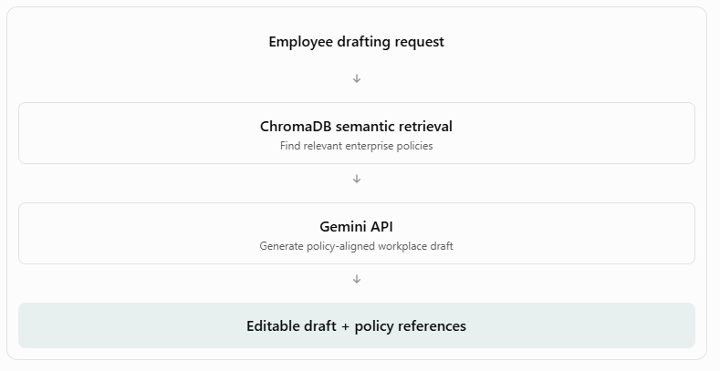

### Step 9A — Create the Draft Generation Service

Create `app/backend/services/draft_service.py`.

We're reusing the services already developed:

- `search_documents()` retrieves relevant policy passages from ChromaDB.
- `generate_response()` sends the prompt to Gemini.
- The draft service combines both to produce policy-grounded workplace text.

The output includes the generated draft and retrieved source passages.

One limitation is that the model may still introduce unsupported details. We'll verify the generated drafts against the source policies during testing.

### Step 9B — Create the FastAPI Endpoint

Update `app/backend/main.py`.

### Step 9C — Test Through Swagger UI

#### Test 1 — Annual Leave Request

```json
{
  "request": "Draft an email to my manager requesting three days of annual leave next month.",
  "draft_type": "email",
  "tone": "professional"
}
```

#### Test 2 — IT Support Ticket

```json
{
  "request": "Create an IT support ticket because my company VPN disconnects repeatedly.",
  "draft_type": "support_ticket",
  "tone": "concise"
}
```

#### Test 3 — Expense Reimbursement Request

```json
{
  "request": "Draft a formal request to reimburse an approved client lunch expense of INR 1200.",
  "draft_type": "formal_request",
  "tone": "formal"
}
```

### Step 9D — Integrate the Draft Generator into Streamlit

Update `app/frontend/streamlit_app.py`.

### Step 9E — Verify the Third NLP Capability

## Step 10 — Integrate DistilBERT with the RAG Workflow

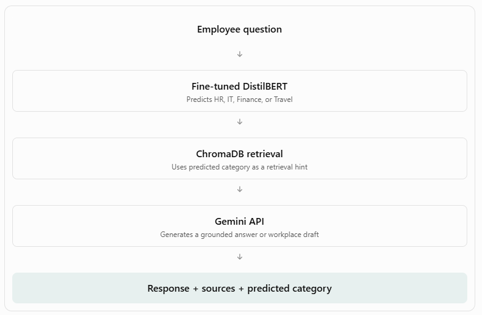

### Step 10A — Add Classification to the RAG Service

Update `app/backend/services/rag_service.py`.

## Step 11A — Evaluate the Enterprise Knowledge Assistant

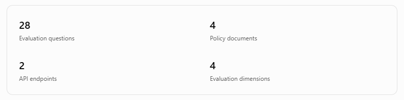

| Metric | What it tells us |
|---|---|
| Retrieval Recall@4 | Whether the expected policy section appears in the top four retrieved passages |
| Answer correctness | Whether the response matches the policy facts |
| Groundedness | Whether the response's claims are supported by retrieved documents |
| API latency | How long the backend takes to return a response |

We'll also test questions for which the documents contain insufficient information.

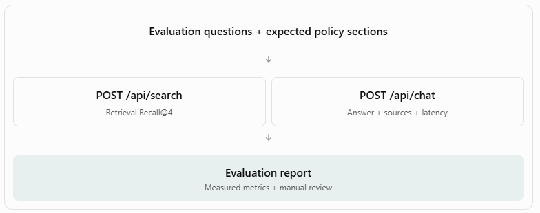

### Step 11A.1 — Create the Evaluation Dataset

```bash
mkdir -p evaluation/results
touch evaluation/rag_test_cases.csv
```

### Step 11A.2 — Create the Automated Evaluation Script

```bash
touch evaluation/evaluate_rag.py
```

**Important technical distinction:** The script measures whether the expected source section appears in the top four retrieved passages. This is more precisely called Hit@4, or Recall@4 when each question has one annotated relevant passage. It does not measure the proportion of all relevant passages retrieved.

The script also records actual answers for manual assessment. It does not automatically claim that generated answers are correct merely because retrieval succeeded.

### Step 11A.3 — Execute the Evaluation

Start the API:

```bash
python -m uvicorn app.backend.main:app \
  --host 0.0.0.0 \
  --port 8000 \
  --reload
```

In another terminal, run the evaluation:

```bash
python -m evaluation.evaluate_rag
```

### Step 11A.4 — Review the Results

After execution, open `evaluation/results/rag_evaluation_results.csv`.

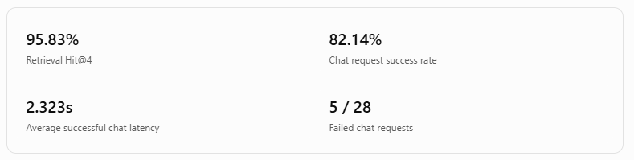

#### Interpretation

- **Retrieval Hit@4: 95.83%**

  Assuming all 24 answerable questions were evaluated, this means the expected policy section appeared among the top four retrieved passages for 23 of 24 questions.

  This is encouraging evidence that our embedding model and ChromaDB retrieval pipeline are working effectively on the fictional policy documents.

- **Chat success rate: 82.14%**

  Of 28 chatbot requests, 23 succeeded and five failed. Although the failures were temporary, they remain part of this evaluation run.

  This highlights an operational limitation: the application depends on an external LLM API, which can experience transient errors or quota restrictions.

- **Average chat latency: 2.323 seconds**

  Successful chatbot requests took approximately 2.3 seconds on average. This is reasonable for an academic prototype, although we have not established a workplace service-level target.

## Step 12 — Cloud Deployment Preparation


### Step 12A — Audit the Existing Project

1. Check Python environment

  python --version
  python -m pip --version

  python -m pip list --format=freeze > installed_packages.txt

2. Check project size

  du -sh models/
  du -sh data/vector_db/
  du -sh .venv/

  find app training data models evaluation \
  -maxdepth 3 -type f \
  | grep -v __pycache__ \
  | sort

3. Protect sensitive files
4. Verify model artifacts

  ls -lh models/eka-distilbert-model/

## Step 12B — Prepare Docker deployment files

1. Create .dockerignore
2. Create start.sh
  This starts FastAPI internally on port 8000 and Streamlit on port 8501.

Only Streamlit needs to be publicly exposed. FastAPI remains accessible within the container.

3. Create a preliminary Dockerfile
4. Record your environment dependencies

     python -m pip freeze > requirements-lock.txt

## Step 12B.2 — Build and Test Docker
docker build -t enterprise-knowledge-assistant:1.0 .

docker run --rm \
  --name eka-app \
  --env-file .env \
  -p 8501:8501 \
  enterprise-knowledge-assistant:1.0

## Step 13 — AWS Deployment


