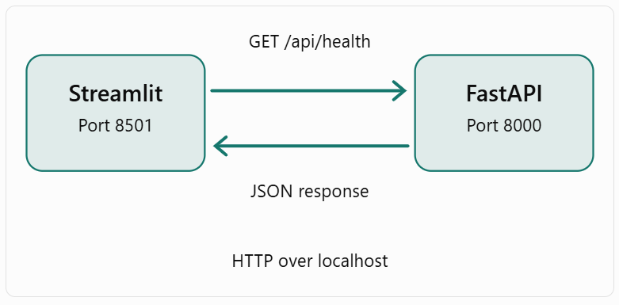
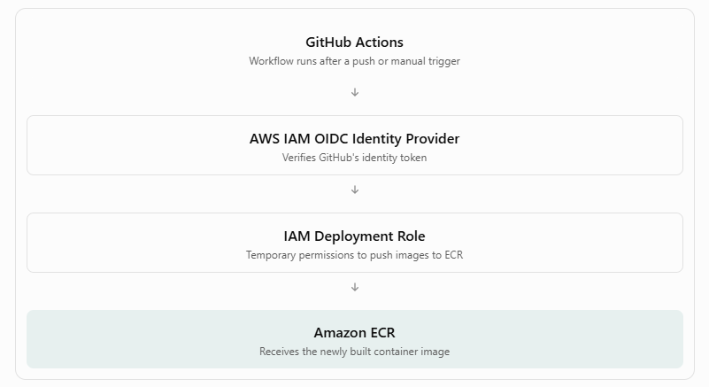
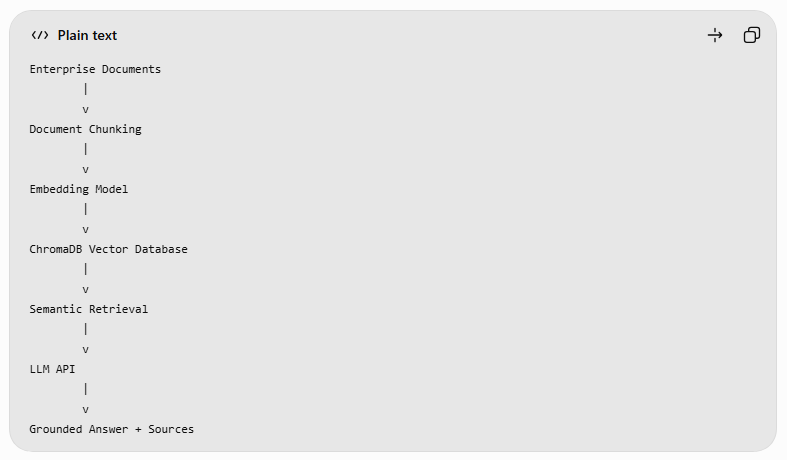
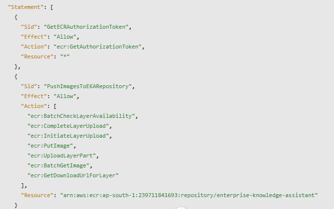
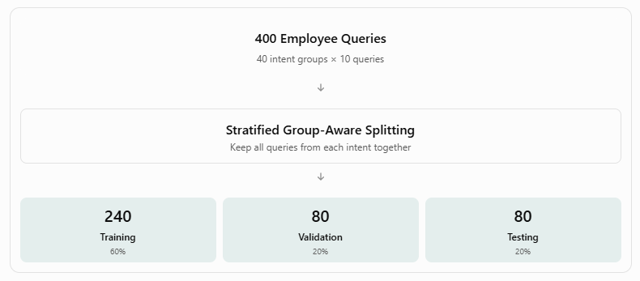
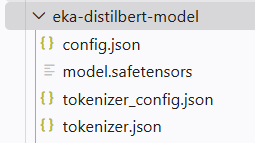
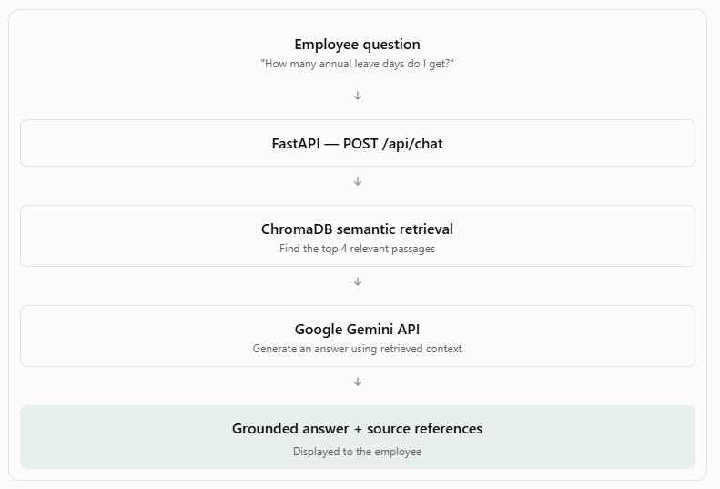

# Enterprise Knowledge Assistant (EKA)

M.Tech AI-ML | API-driven Cloud Native Solutions

## Project Objective

Develop an API-driven enterprise knowledge assistant
using NLP, model fine-tuning, and Retrieval-Augmented
Generation (RAG).

## Technology Stack

- Python
- FastAPI
- Streamlit
- Hugging Face Transformers
- ChromaDB
- LLM API

## Project Status

## Step 1 — Environment setup
    python --version
    python -m venv .venv
    cmd: .\.venv\Scripts\Activate.ps1 / bash: source .venv/bin/activate
    python -m pip install --upgrade pip
    pip install -r requirements.txt
    
## Step 2 — Build REST API using FastAPI    
    python -m pip show fastapi uvicorn
    mkdir -p app/backend
    touch app/__init__.py
    touch app/backend/__init__.py
    touch app/backend/main.py

    The __init__.py files mark the directories as Python packages.

1. FastAPI()

Creates our backend application.

2. @app.get("/")

Defines a REST API endpoint that responds to an HTTP GET request at /.

3. @app.get("/api/health")

Defines a second endpoint for checking whether the application is running.

4. Returning a Python dictionary

FastAPI automatically serializes the dictionary into a JSON response.

    python -m uvicorn app.backend.main:app --host 0.0.0.0 --port 8000 --reload
    curl http://127.0.0.1:8000/
    curl http://127.0.0.1:8000/api/health
    Interactive API documentation : http://localhost:8000/docs

    Argument	        Meaning
    app.backend.main	Python module containing our application
    :app	            FastAPI application object
    --host 0.0.0.0	    Listen on all network interfaces
    --port 8000	        Run on port 8000
    --reload	        Restart automatically when code changes

## Step 3 — Build the Streamlit Frontend and Connect It to FastAPI

    - The user opens the Streamlit application.
    - Streamlit sends an HTTP GET request to FastAPI.
    - FastAPI processes the request.
    - FastAPI returns a JSON response.
    - Streamlit displays the response.

    mkdir -p app/frontend
    touch app/frontend/__init__.py
    touch app/frontend/streamlit_app.py

## Step 4 — Preparing the Enterprise Knowledge Base

    mkdir -p data/documents

    Document 1 — Employee Leave Policy - Create data/documents/leave_policy.txt

    Document 2 — IT Support Policy - Create data/documents/it_support_policy.txt

    Document 3 — Expense Reimbursement Policy - Create data/documents/expense_policy.txt

    Document 4 — Business Travel Policy - Create data/documents/travel_policy.txt

Create a document service

    mkdir -p app/backend/services
    touch app/backend/services/__init__.py
    touch app/backend/services/document_service.py

    Path(__file__).resolve().parents[3] identifies the project root based on the service file's location.

    glob("*.txt") finds text documents in the directory.

    file_path.stem extracts the filename without its extension.

Create document API endpoints

    curl http://127.0.0.1:8000/api/documents
    curl http://127.0.0.1:8000/api/documents/leave_policy
    curl -i http://127.0.0.1:8000/api/documents/unknown_policy

Integrate the document explorer into Streamlit

## Step 5 — Preparing the Dataset for DistilBERT Fine-Tuning

We selected DistilBERT, a compact transformer-based language model, for classifying employee queries.

The classifier will help identify the domain of an employee's query, which can later guide our RAG document retrieval.

 This is a multi-class, single-label classification problem: each query receives exactly one category.

    Label ID	Category	            Example
    0	        HR & Leave	            "How do I apply for sick leave?"
    1	        IT Support	            "My VPN connection is failing."
    2	        Finance & Expenses	    "When will my claim be reimbursed?"
    3	        Travel & Operations	    "How do I book a business flight?"

 Dataset format CSV file with two columns:
    - text: Employee's query.
    - label: Numerical category identifier.

 Create the dataset directory

    mkdir -p data/training

 Create a file: data/training/employee_queries.csv

 Install the data-processing libraries

    python -m pip show pandas scikit-learn

 Create the dataset preparation script

    mkdir -p training
    touch training/prepare_dataset.py
    python training/prepare_dataset.py

## Step 6 — Fine-Tuning DistilBERT for Enterprise Query Classification

## Step 6A.1 — Build the Curated Intent Catalog

   Each query will contain:
   Field	        Purpose
   text	        Employee's question
   label	        Classification target: 0, 1, 2, or 3
   intent_group	Groups queries that express the same underlying intent

Important distinction: The model will predict label, not intent_group. The intent group is used for dataset organization and leakage-aware evaluation.

 Create the intent catalog file

    mkdir -p data/training training
    Create: data/training/intent_catalog.json

 Create the dataset generation script

    touch training/generate_dataset.py

    It performs five operations:
    1. Reads the intent catalog from JSON.
    2. Iterates through categories, intents, and questions.
    3. Checks for empty queries and exact duplicates (ignoring case and repeated whitespace).
    4. Creates a structured dataset.
    5. Exports the dataset to CSV.

 Execute the dataset generator

    python training/generate_dataset.py

 Verify the generated CSV

    head -n 6 data/training/employee_queries.csv

## Step 6A.2 — Expand the Dataset to 400 Queries

Run the generator again after updating json with new intent each category

    python training/generate_dataset.py

## Step 6A.3 — Complete the Intent Catalog

 Create a script to expand the catalog

    touch training/expand_intents.py

 Run the expansion script

    python training/expand_intents.py

 Regenerate the dataset

    python training/generate_dataset.py

## Step 6A.4 — Expand to 400 queries

 Create a variation template

    Direct question
    Conversational request
    Scenario-based question
    Procedural question
    Indirect question

 Create an expansion worksheet

    touch training/create_expansion_template.py
    python training/create_expansion_template.py

 Populate the worksheet with diverse queries

 ## Step 6B — Dataset Validation and Group-Aware Splitting

 Now that we have prepared our 400-query dataset, we'll create the training, validation, and test datasets for both:

    1. TF-IDF + Logistic Regression (baseline model)
    2. Fine-tuned DistilBERT (transformer model)

    Understand why group-aware splitting matters

    Suppose our dataset contains:
    Query	                                Intent group
    How can I reset my company password?	password_reset
    I forgot my work login credentials.	    password_reset
    Where can I reset my account password?	password_reset

    If we randomly split individual rows, similar questions could appear in both training and testing.

    This creates a risk of data leakage, resulting in overly optimistic evaluation metrics.

    Instead, we'll keep all questions belonging to an intent group in the same split.

 Create the dataset validation and splitting script

    touch training/prepare_dataset.py
    Run the script: python training/prepare_dataset.py

    The enterprise query dataset was divided into training, validation, and test subsets using an intent-group-aware strategy. All queries belonging to the same intent were assigned to the same subset, reducing paraphrase leakage between training and evaluation. Category balance was maintained across the three subsets. A fixed random seed was used to support reproducibility.

## Step 6C — Train the TF-IDF baseline

Why do we need a baseline?
Suppose we fine-tune DistilBERT and achieve 85% accuracy. Is that good?

We cannot determine that from the number alone.

If a simpler Logistic Regression model achieves 90%, the additional computational cost of DistilBERT might not be justified for this particular dataset.

 Create the baseline training script

    touch training/train_baseline.py

 Why use a Pipeline?

    A scikit-learn Pipeline ensures that the TF-IDF vectorizer and Logistic Regression classifier operate together.

    It also prevents the vectorizer from learning vocabulary and IDF statistics from the validation or test datasets.

    Why test different C values?

    The C parameter controls regularization strength.

    Smaller values mean stronger regularization, while larger values allow the classifier to fit the training data more closely.

    We'll select the value that produces the best validation macro F1-score.

    Why evaluate the test set only after model selection?

    The test set should remain independent of hyperparameter selection. We use validation performance to choose the model and test performance to estimate generalization.

 Execute the baseline training

    python training/train_baseline.py

 Test the saved model with new queries

    touch training/test_baseline.py
    Run: python training/test_baseline.py

 Save evidence 

 ## Step 6D — Fine-Tune DistilBERT Using Our Final Dataset

      create notebook/EKA_DistilBERT_FineTuning.ipynb

 ## Step 6E — Integrate the Fine-Tuned Model into FastAPI

 Download and extract the model /content/eka-distilbert-model.zip
 
      mkdir -p models/distilbert
      unzip -o eka-distilbert-model.zip -d models/

 Install inference dependencies

 

 Create the classifier service

      touch app/backend/services/classifier_service.py

      Loads your locally saved fine-tuned model.
      Tokenizes the employee query.
      Runs inference without updating model parameters.
      Converts logits into softmax scores.
      Returns the predicted category and confidence.

 Add the classification API endpoint

      curl -X POST \
      http://127.0.0.1:8000/api/classify \
      -H "Content-Type: application/json" \
      -d '{"query":"How do I apply for annual leave?"}'

## To commit the finetuned model to Github LFS

      git lfs install
      git lfs track "models/eka-distilbert-model/model.safetensors"
      
      The second command creates or updates .gitattributes, telling Git to store that weights file with LFS.

 Stage the LFS rules and the four files the app needs:

      git add .gitattributes .gitignore \
      models/eka-distilbert-model/config.json \
      models/eka-distilbert-model/model.safetensors \
      models/eka-distilbert-model/tokenizer.json \
      models/eka-distilbert-model/tokenizer_config.json

 Verify

      git lfs ls-files
      git status -sb

## Step 7 — Building the RAG Pipeline

### Step 7A — Implement Document Chunking

Before creating embeddings, we need to divide our enterprise documents into smaller passages called chunks.

Why is chunking necessary?

LLMs and embedding models work better when relevant information is organized into manageable passages.

For example, an employee asking about leave approval does not necessarily need the entire HR policy. The retrieval system should identify the specific section describing approval.

We'll initially use a simple section-aware chunking approach because our four fictional policy documents already have numbered sections.

 Create the chunking service

      touch app/backend/services/chunking_service.py

      pattern = r"(?m)^(?=\d+\.\s+[A-Z])" This identifies the beginning of numbered sections such as

      Our implementation preserves the section heading inside each chunk.

      The first chunk may contain the document title and metadata. We'll keep it for now, although we may exclude metadata-only chunks from semantic retrieval later.

 Create a test script

      touch training/test_chunking.py
      Run - python -m training.test_chunking

### Step 7B — Generate Embeddings and Build the ChromaDB Vector Database

   Our selected embedding model, sentence-transformers/all-MiniLM-L6-v2, produces 384-dimensional embeddings.

   The same model will encode both policy passages and employee questions. ChromaDB will compare these vectors to find semantically similar passages.

ChromaDB will store the passage embeddings and their metadata, allowing us to search them efficiently.

 Install the required libraries

      python -m pip show chromadb sentence-transformers

 Create the vector database service

      touch app/backend/services/vector_service.py

   SentenceTransformer - Loads the embedding model. The first execution may download model files from Hugging Face.
   PersistentClient - Creates a persistent vector database on disk.Unlike an in-memory database, the stored embeddings remain available after the application restarts.
   Adds or updates records with the supplied IDs.

   One limitation: upsert does not automatically remove chunks that were deleted from the source documents. For our initial static knowledge base this is acceptable, but we'll improve index synchronization when adding document-upload functionality.

   Cosine distance - We configured ChromaDB to use cosine distance.For normalized embeddings, smaller distances generally indicate greater semantic similarity. The distance is not a calibrated probability that the retrieved passage is correct.

 Create a vector indexing script

   We need a script that loads the enterprise documents, creates embeddings, and stores them in ChromaDB.

   touch training/build_vector_db.py
   Run : python -m training.build_vector_db

Test semantic retrieval
   Now we'll test whether our vector database can find relevant information.

   touch training/test_retrieval.py
   Run : python -m training.test_retrieval

 The correct passage should ideally appear among the top three retrieved results.

 However, semantic search is probabilistic, so we'll verify the actual ranking rather than assuming that every query will retrieve the correct passage.

 Expose semantic search through FastAPI

      Update app/backend/main.py
      POST /api/search

## Step 7C — Build Our RAG Chatbot Using Google Gemini API

## Step 7C.1 — Create Gemini credentials securely

Create .env in the project root:

   touch .env
   chmod 600 .env
   Intsall dependencies
   python -m pip show google-genai python-dotenv

## Step 7C.2 — Implement llm_service.py

   touch app/backend/services/llm_service.py

Understanding the implementation

load_dotenv() loads the secret from the local environment file.

get_gemini_client() creates the authenticated API client and caches it for reuse.

client.models.generate_content() sends our request to Gemini and returns generated content. This method is supported by the official Google Gen AI SDK. 
Google APIs

temperature=0.1 favors relatively consistent responses, which is useful for policy question answering. It does not guarantee factual accuracy.

## Step 7C.3 — Test Gemini independently

   touch training/test_gemini.py
   python -m training.test_gemini

## Step 7C.4 — Implement the RAG service

   touch app/backend/services/rag_service.py

1. Retrieves the top four semantically relevant passages.
2. Combines the passages into a context block.
3. Sends the context and employee question to Gemini.
4. Returns the generated answer and the retrieved source metadata.

Important: The sources array contains retrieved passages, not independently verified citations. The LLM is instructed to cite those passages, but we'll still need to evaluate whether each answer is genuinely supported.

## Step 7C.5 — Create the FastAPI chat endpoint

   Update app/backend/main.py

## Step 7C.6 — Test the complete RAG pipeline

   python -m uvicorn app.backend.main:app \
  --host 0.0.0.0 \
  --port 8000 \
  --reload

## Step 7D — Integrate the RAG Chatbot into Streamlit

Our objective is to create a chat interface where employees can:

1. Enter questions in natural language.
2. View AI-generated answers.
3. See supporting document references.
4. Continue a conversation within the interface.
5. Receive meaningful error messages if the backend is unavailable.

 Update the Streamlit chatbot page 

   app/frontend/streamlit_app.py

Understanding the implementation
st.session_state

Stores conversation messages across Streamlit reruns within the current session.

st.chat_message()

Displays messages using a chat-style layout.

st.chat_input()

Provides an input box for employee questions.

requests.post()

Sends the question to our FastAPI RAG endpoint.

st.expander()

Allows employees to inspect the retrieved passages supporting the answer.

An important distinction: this version displays conversation history, but each backend request is still independent. Gemini does not receive earlier messages, so the system doesn't yet support context-dependent follow-up questions such as "What about the next year?" We'll add conversational context only if needed after the core requirements are complete.

 Run the complete application

 Terminal 1 — FastAPI

   python -m uvicorn app.backend.main:app \
   --host 0.0.0.0 \
   --port 8000 \
   --reload

 Terminal 2 — Streamlit

   python -m streamlit run app/frontend/streamlit_app.py \
   --server.address 0.0.0.0 \
   --server.port 8501

## Step 8 — Implement Document Summarization

## Step 8A — Create the summarization backend

We'll reuse the existing llm_service.py and document_service.py, so we don't need to introduce any new libraries.

   Create: touch app/backend/services/summarizer_service.py

   Add the summarization API : app/backend/main.py

## Step 8B — Test through Swagger UI

## Step 8C — Integrate the Document Summarizer into Streamlit

   app/frontend/streamlit_app.py

## Step 9 — Implement Workplace Draft Generation

## Step 9A — Create the draft generation service
Create: touch app/backend/services/draft_service.py

Understanding the code
We're reusing the services already developed:
- search_documents() retrieves relevant policy passages from ChromaDB.
- generate_response() sends the prompt to Gemini.
- The draft service combines both to produce policy-grounded workplace text.
The output includes the generated draft and retrieved source passages.

One limitation is that the model may still introduce unsupported details. We'll verify the generated drafts against the source policies during testing.

## Step 9B — Create the FastAPI endpoint

   Open: app/backend/main.py

## Step 9C — Test through Swagger UI

Test 1 — Annual leave request
{
  "request": "Draft an email to my manager requesting three days of annual leave next month.",
  "draft_type": "email",
  "tone": "professional"
}

Test 2 — IT support ticket
{
  "request": "Create an IT support ticket because my company VPN disconnects repeatedly.",
  "draft_type": "support_ticket",
  "tone": "concise"
}

Test 3 — Expense reimbursement request
{
  "request": "Draft a formal request to reimburse an approved client lunch expense of INR 1200.",
  "draft_type": "formal_request",
  "tone": "formal"
}

## Step 9D — Integrate the Draft Generator into Streamlit

Open: app/frontend/streamlit_app.py

## Step 9E — Verify the third NLP capability