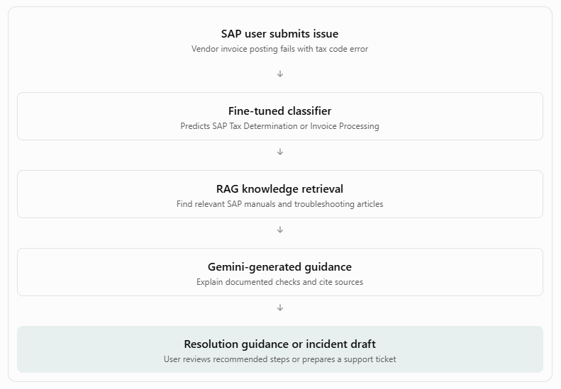

Revised project scenario
Proposed title:

SAP Knowledge and Incident Support Assistant — An API-Driven AI Solution for Enterprise Application Support

Domain: Enterprise IT / SAP Application Support

AI category: Natural Language Processing (NLP)
Workplace problem
In large organizations, SAP users frequently encounter issues while performing business transactions, such as invoice processing, tax determination, accounts receivable payment clearing, or expense reclassification.

To resolve these issues, users typically need to search SAP user manuals, knowledge-base articles, troubleshooting guides, and historical incident records.

When self-service troubleshooting is unsuccessful, users raise support tickets, often without sufficient diagnostic information. This can lead to additional clarification cycles and longer resolution times.
Proposed AI solution
An AI assistant that helps SAP users:
- Search user manuals and knowledge articles using natural-language questions.
- Receive troubleshooting guidance grounded in approved documentation.
- Summarize lengthy SAP procedures or knowledge articles.
- Generate structured incident tickets containing the issue description, affected process, observed error, and relevant troubleshooting information.
- Classify support requests into SAP business-process categories.
The assistant will prepare tickets for user review, not create tickets in a real SAP or ITSM system at this stage.

2. How our existing application maps to SAP support
Existing capability	Revised SAP use case
RAG chatbot	SAP user-manual and knowledge-article assistant
Document summarizer	Summarize SAP procedures and troubleshooting guides
Workplace draft generator	Generate structured SAP incident tickets
Fine-tuned DistilBERT	Classify SAP support requests
ChromaDB	Store and retrieve SAP knowledge articles
FastAPI	Expose classification, retrieval, and generation APIs
Streamlit	Provide the SAP support assistant interface

This preserves the three NLP sub-tasks required by your professor.
3. Proposed SAP support categories
We can focus on four business-process areas.

1. Invoice Processing (AP)

Examples: invoice posting errors, purchase-order mismatches, duplicate invoice warnings, and blocked invoices.

2. Tax Determination

Examples: incorrect tax codes, missing tax configurations, tax calculation discrepancies, and tax-related posting errors.

3. Accounts Receivable (AR) Payments

Examples: unapplied payments, payment clearing failures, customer-account reconciliation, and open-item mismatches.

4. Expense Reclassification

Examples: incorrect cost-center assignments, general-ledger account corrections, expense reclassification requests, and posting validation errors.

These are proposed support scenarios. We will need synthetic, SAP-relevant documentation to support them; our existing NovaTech HR and travel documents do not establish SAP-specific troubleshooting procedures.

4. Example end-to-end SAP support workflow
Consider this user question:
"I am trying to post a vendor invoice in SAP, but the system shows a tax code error. What should I do?"

Current process: SAP user encounters an error → searches manuals/KB articles → contacts support → creates a ticket → support analyst requests missing details → issue investigation begins.

Proposed process: SAP user describes the error → AI retrieves relevant knowledge → provides grounded troubleshooting guidance → generates a structured incident draft if needed → user reviews and submits it through the approved support process.