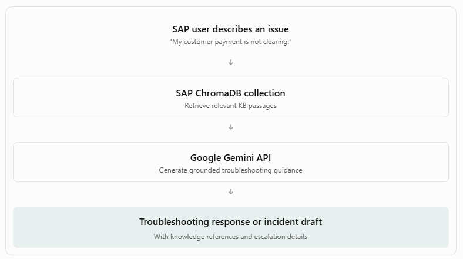

Revised project scenario
Proposed title:

SAP Knowledge and Incident Support Assistant — An API-Driven AI Solution for Enterprise Application Support

Domain: Enterprise IT / SAP Application Support

AI category: Natural Language Processing (NLP)
Workplace problem
In large organizations, SAP users frequently encounter issues while performing business transactions, such as invoice processing, tax determination, accounts receivable payment clearing, or expense reclassification.

To resolve these issues, users typically need to search SAP user manuals, knowledge-base articles, troubleshooting guides, and historical incident records.

When self-service troubleshooting is unsuccessful, users raise support tickets, often without sufficient diagnostic information. This can lead to additional clarification cycles and longer resolution times.
Proposed AI solution
An AI assistant that helps SAP users:
- Search user manuals and knowledge articles using natural-language questions.
- Receive troubleshooting guidance grounded in approved documentation.
- Summarize lengthy SAP procedures or knowledge articles.
- Generate structured incident tickets containing the issue description, affected process, observed error, and relevant troubleshooting information.
- Classify support requests into SAP business-process categories.
The assistant will prepare tickets for user review, not create tickets in a real SAP or ITSM system at this stage.

2. How our existing application maps to SAP support
Existing capability	Revised SAP use case
RAG chatbot	SAP user-manual and knowledge-article assistant
Document summarizer	Summarize SAP procedures and troubleshooting guides
Workplace draft generator	Generate structured SAP incident tickets
Fine-tuned DistilBERT	Classify SAP support requests
ChromaDB	Store and retrieve SAP knowledge articles
FastAPI	Expose classification, retrieval, and generation APIs
Streamlit	Provide the SAP support assistant interface

This preserves the three NLP sub-tasks required by your professor.
3. Proposed SAP support categories
We can focus on four business-process areas.

1. Invoice Processing (AP)

Examples: invoice posting errors, purchase-order mismatches, duplicate invoice warnings, and blocked invoices.

2. Tax Determination

Examples: incorrect tax codes, missing tax configurations, tax calculation discrepancies, and tax-related posting errors.

3. Accounts Receivable (AR) Payments

Examples: unapplied payments, payment clearing failures, customer-account reconciliation, and open-item mismatches.

4. Expense Reclassification

Examples: incorrect cost-center assignments, general-ledger account corrections, expense reclassification requests, and posting validation errors.

These are proposed support scenarios. We will need synthetic, SAP-relevant documentation to support them; our existing NovaTech HR and travel documents do not establish SAP-specific troubleshooting procedures.

4. Example end-to-end SAP support workflow
Consider this user question:
"I am trying to post a vendor invoice in SAP, but the system shows a tax code error. What should I do?"

Current process: SAP user encounters an error → searches manuals/KB articles → contacts support → creates a ticket → support analyst requests missing details → issue investigation begins.

Proposed process: SAP user describes the error → AI retrieves relevant knowledge → provides grounded troubleshooting guidance → generates a structured incident draft if needed → user reviews and submits it through the approved support process.

## Step 11B.1 — Build the SAP Support Knowledge Base

We'll now adapt our Enterprise Knowledge Assistant to the SAP S/4HANA Finance support scenario for your individual Situated Learning assignment.

We'll preserve your existing NovaTech implementation and evaluation results.

Our immediate goal is to create four synthetic SAP knowledge-base articles and index them separately in ChromaDB.

1. SAP knowledge-base structure
Document	Support area	Example issue
sap_invoice_kb.txt	Accounts Payable	Vendor invoice posting fails
sap_tax_kb.txt	Tax Determination	Tax code validation error
sap_ar_payment_kb.txt	Accounts Receivable	Incoming payment cannot be cleared
sap_expense_reclass_kb.txt	Expense Reclassification	Expense posted to incorrect cost center

2. Create a separate SAP document directory

   mkdir -p data/sap_documents

   Document 1 — Vendor Invoice Troubleshooting
   Create data/sap_documents/sap_invoice_kb.txt

   Document 2 — Tax Determination
   Create data/sap_documents/sap_tax_kb.txt

   Document 3 — AR Payment Clearing
   Create data/sap_documents/sap_ar_payment_kb.txt

   Document 4 — Expense Reclassification
   Create data/sap_documents/sap_expense_reclass_kb.txt

   3. Index SAP documents in a separate ChromaDB collection
Our existing vector database contains NovaTech HR, IT, Finance, and Travel policies.

We must keep SAP documents separate so the chatbot doesn't mix unrelated policies.

Create:

touch app/backend/services/sap_vector_service.py

This creates a dedicated SAP vector collection while preserving the existing NovaTech collection.
4. Build and test the SAP index
Create:

touch training/test_sap_retrieval.py
python -m training.test_sap_retrieval

## Step 11B.2 — SAP Support Chatbot and Incident Draft Generation.

### 1. SAP RAG service

1. Create: touch app/backend/services/sap_rag_service.py

This service reuses our existing Gemini API integration.

It retrieves relevant SAP knowledge articles, constructs a grounded prompt, and generates a structured troubleshooting response.

2. Add the FastAPI endpoint app/backend/main.py

This creates a dedicated SAP support API without modifying the existing NovaTech chatbot.

3. Test through Swagger UI

{
  "query": "I cannot post a vendor invoice because SAP displays a validation error. What should I check?",
  "top_k": 4
}

Additional test cases
Question	Expected knowledge area
Why is SAP calculating an incorrect tax amount?	Tax Determination
My customer payment is not clearing against an invoice.	AR Payment Clearing
An expense was posted to the wrong cost center.	Expense Reclassification
How do I change SAP production configuration?	Insufficient information / authorized escalation

4. Add SAP Support to Streamlit

## Step 11B.3 — Build the SAP Incident Ticket Generator

This will demonstrate how our AI solution supports the complete workflow:

SAP user encounters an issue → searches knowledge articles → receives troubleshooting guidance → prepares an incident ticket if unresolved.

The ticket will be a draft for review. It will not create an incident in a live ITSM system

2. Define the ticket structure
Our generated incident draft will contain:
Field	Description
Short description	Concise summary of the SAP issue
Business process	Invoice, Tax, AR Payment, or Expense Reclassification
Detailed description	User-reported symptoms
Error message	Exact error text, if provided
Business impact	Effect on the user's work
Troubleshooting performed	Steps explicitly confirmed by the user
Suggested diagnostic checks	Relevant checks from knowledge articles
Missing information	Details needed by support
Suggested assignment area	SAP Finance Support
Knowledge references	Retrieved SAP KB articles

3. Create: touch app/backend/services/sap_ticket_service.py

4. Add the FastAPI endpoint app/backend/main.py

5. Test through Swagger UI
Open /docs and find:

POST /api/sap/ticket-draft

Use the following request:
{
  "issue_description": "I am unable to post a vendor invoice in SAP because the system displays a validation error.",
  "business_impact": "Invoice processing is blocked and payment processing may be delayed.",
  "error_message": "Validation error during invoice posting"
}

6. Integrate the Ticket Generator into Streamlit

 Terminal 1 — FastAPI

   python -m uvicorn app.backend.main:app \
   --host 0.0.0.0 \
   --port 8000 \
   --reload

 Terminal 2 — Streamlit

   python -m streamlit run app/frontend/streamlit_app.py \
   --server.address 0.0.0.0 \
   --server.port 8501

AP Invoice Posting:
Issue description
Unable to post a vendor invoice because SAP displays a validation error.
Business impact
Invoice processing is blocked and payment processing may be delayed.
Error message
Validation error during invoice posting

Tax Determination:
Issue description
An invoice cannot be posted because the calculated tax amount does not match the expected amount.
Business impact
Invoice posting is delayed pending tax validation.
Error message
Not provided

AR Payment Clearing:
Issue description
An incoming customer payment cannot be matched to an outstanding customer invoice.
Business impact
Customer account reconciliation is delayed.
Error message
Not provided

Expense Reclassification:
Issue description
An expense was posted to the wrong cost center and requires review.
Business impact
Cost center reporting may be inaccurate until corrected.
Error message
Not provided

## Step 12 — Deployment Preparation